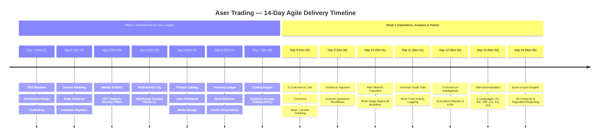

# Aser Trading — Two-Week Agile Development Timeline & Milestone Delivery Report

**Project**: Public Website, E-Commerce Platform & Multi-Branch Inventory Management System  
**Client / Enterprise**: Aser Trading  
**Sprint Window**: 14 Days (October 21, 2026 – November 4, 2026)  
**Technology Stack**: Spring Boot (Java 21), PostgreSQL, Hibernate/JPA, Apache POI, JWT Security, Angular 20, TypeScript, SheetJS  
**Currency**: Ethiopian Birr (ETB)  
**Status**: Production-Ready / Feature-Complete  

---

## 📅 Two-Week Sprint Schedule & Milestones

---

## 📋 Daily Milestone & Delivery Breakdown

### Week 1: Foundation, Ledger Engine & Core Inventory

#### Day 1 — October 21, 2026: Project Scaffolding & Architecture Baseline
- **Deliverables**:
  - Formalized Software Requirements Specification (SRS v1.0) based on Aser Trading business directives.
  - Multi-tier system architecture design separating Client Presentation, REST API Gateway, Domain Services, and Relational Persistence.
  - Initialized Spring Boot 4 (Java 21) backend with Docker Compose setup for PostgreSQL and Liquibase/Flyway migrations.
  - Angular 20 frontend initialization with brand tokens (Primary Blue `#1e30c4`, Slate, Ink, Gold accents).

#### Day 2 — October 22, 2026: Relational Domain Modeling & Database Schemas
- **Deliverables**:
  - Implemented core JPA entities: `User`, `Role`, `Branch`, `Warehouse`, `Product`, `Category`, `UnitOfMeasure`, `StockBalance`, `StockMovement`, `Order`, `StockTransfer`.
  - Configured database indices, foreign key constraints, composite unique keys, and optimistic locking (`@Version`).

#### Day 3 — October 23, 2026: Identity & Role-Based Access Control (RBAC)
- **Deliverables**:
  - Implemented stateless JWT authentication (`jjwt` 0.12.6) with cryptographic signing and token expiration.
  - Built 9 system roles with strict segregation of duties:
    - `SYSTEM_ADMINISTRATOR`
    - `COMPANY_MANAGER`
    - `INVENTORY_MANAGER`
    - `BRANCH_MANAGER`
    - `STOREKEEPER`
    - `PROCUREMENT_OFFICER`
    - `SALES_OFFICER`
    - `ACCOUNTANT_AUDITOR`
    - `WEBSITE_MANAGER` / `CUSTOMER`
  - Created authentication endpoints (`/api/v1/auth/login`, `/api/v1/auth/profile`, `/api/v1/auth/change-password`).

#### Day 4 — October 25, 2026: Organization & Multi-Branch Scoping
- **Deliverables**:
  - Multi-branch organizational structure supporting Headquarters and Regional Operating Branches.
  - Multiple warehouse facilities per branch with default receiving warehouse designation.
  - Enforced data isolation: Storekeepers and Branch Managers are restricted to their authorized operating branch.

#### Day 5 — October 26, 2026: Product Catalog & Media Management
- **Deliverables**:
  - 5 core commercial categories: *Printing Press Services*, *Branding & Promotion*, *Garment Materials*, *Printing Supplies*, *Equipment Distribution*.
  - Flexible Units of Measure (UOM) with conversions: piece, meter, roll, kg, ream, box, pack, liter, set.
  - Dual pricing modes: Fixed Pricing vs. Custom Technical Quotation Required.
  - Media upload controller with local disk storage and URL resolution.

#### Day 6 — October 27, 2026: Multi-Branch Inventory Ledger & Balances
- **Deliverables**:
  - Centralized inventory ledger tracking physical on-hand, reserved, and available-to-sell quantities.
  - Real-time stock status determination (`IN_STOCK`, `LOW_STOCK`, `OUT_OF_STOCK`).
  - Low stock alerts triggered automatically against configurable reorder thresholds.

#### Day 7 — October 28, 2026: Weighted-Average Costing (WAC) Engine
- **Deliverables**:
  - Implemented SRS Section 7.1 Weighted-Average Costing formula:
    $$\text{New Average Cost} = \frac{(\text{Current Qty} \times \text{Current Avg Cost}) + (\text{Received Qty} \times \text{Inbound Cost})}{\text{Total New Qty}}$$
  - Inbound supplier goods receipt recalculates unit cost atomically within database transactions.
  - Outbound issues, sales dispatch, and stock adjustments record cost snapshots for audit integrity.

---

### Week 2: Workflows, Analytics, i18n & Production Hardening

#### Day 8 — October 29, 2026: E-Commerce Operations & Order Lifecycle
- **Deliverables**:
  - Shopping cart with real-time stock validation and server-side pricing verification.
  - Order checkout supporting Branch Pickup or Delivery to customer address.
  - Manual bank transfer verification workflow with payment reference uploads.
  - Atomic stock reservation ensuring zero overselling across branches.

#### Day 9 — October 30, 2026: Technical Inquiries & Custom Quotation Engine
- **Deliverables**:
  - Customer quotation submission portal for custom print jobs and equipment requisition.
  - Administrative review and pricing interface to formulate official quotes with notes.
  - Status progression: `PENDING` → `UNDER_REVIEW` → `QUOTED` → `ACCEPTED` / `DECLINED`.

#### Day 10 — October 31, 2026: Controlled Inter-Branch Transfer Workflow
- **Deliverables**:
  - Strict 4-step transfer workflow enforcing segregation of duties:
    1. **Requisition**: Origin storekeeper creates transfer request (`PENDING_APPROVAL`).
    2. **Authorization**: Administrator / Branch Manager authorizes transfer (`APPROVED`).
    3. **Dispatch**: Origin warehouse issues goods into transit (`IN_TRANSIT`).
    4. **Receipt & Reconciliation**: Destination storekeeper receives shipment and logs any discrepancies (`RECEIVED` / `DISCREPANCY_REVIEW`).

#### Day 11 — November 01, 2026: Forensic Audit Trail & Real-Time Activity Logs
- **Deliverables**:
  - Append-only forensic audit log entity and asynchronous event interception.
  - Captures actor identity, IP address, module, entity ID, action timestamp, and JSON forensic details.
  - Real-time audit search and filtering interface for Accountants and System Administrators.

#### Day 12 — November 02, 2026: Commercial Intelligence & Executive Analytics
- **Deliverables**:
  - Real-time analytics engine calculating:
    - Total realized revenue and average order value (ETB).
    - Aggregate inventory valuation using Weighted-Average Costing.
    - Consolidated cross-branch stock counts and warehouse breakdown.
    - Transfer logistics efficiency and discrepancy ratios.
  - Interactive executive dashboard with dynamic charts and summary metrics.

#### Day 13 — November 03, 2026: Full Internationalization (i18n) Across 6 Languages
- **Deliverables**:
  - Internationalized translation bundles stored under `public/i18n/` and `src/assets/i18n/`:
    - **Tigrigna (ትግርኛ)**
    - **Amharic (አማርኛ)**
    - **Afan Oromo (Afaan Oromoo)**
    - **English**
    - **Spanish (Español)**
    - **Chinese (中文)**
  - Dynamic language selector in user profile dropdown with instant live UI reactivity.
  - Time-based greeting ("Good morning" / "Good afternoon" / "Good evening") mapped to local time and active language.

#### Day 14 — November 04, 2026: High-Performance Excel Export Engine
- **Deliverables**:
  - **Server-Side Export Engine** (`ExportController` & `ExcelExportService` using Apache POI):
    - Multi-sheet commercial intelligence workbook (`Executive Summary`, `Stock Valuation (WAC)`, `Branch Stock Breakdown`, `Transfer Logistics`).
    - Parametric endpoints supporting **All Contents** (`exportAll=true`) or **Requested Page Only** (`exportAll=false&page=X&size=Y`).
    - Dedicated Excel exports for Balances, Stock Movements, Orders, Products, Transfers, and Audit Logs.
  - **Client-Side Export Service** (SheetJS integration for offline resilience).
  - Production build verification (`mvnw compile` & `ng build`: 0 errors).

---

## 🔒 Security & Compliance Summary
- **Stateless JWT Security**: HMAC-SHA256 token verification on all protected endpoints.
- **Strict Role Boundaries**: Unauthorized role access blocked via `@PreAuthorize`.
- **Financial Invariance**: Weighted-average costing calculated server-side with `BigDecimal` rounding to 2 decimal places.
- **Forensic Auditability**: Every critical data mutation logged to immutable audit tables.
